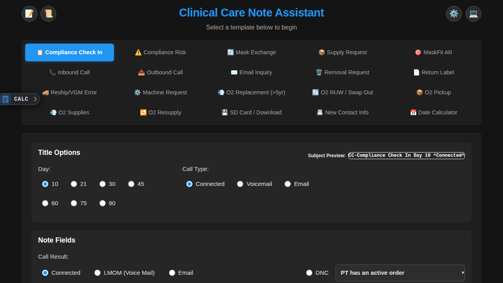
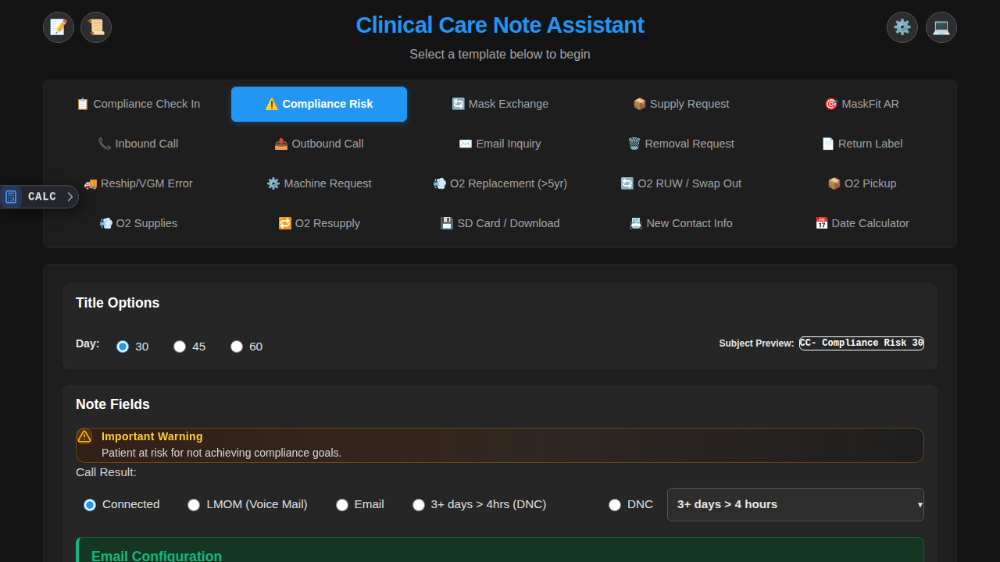
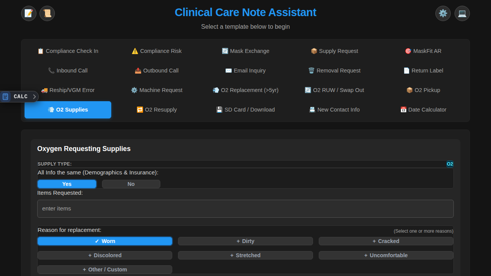

# Clinical Care Note Assistant

A simple, effective tool for clinical documentation designed specifically for nationwide medical clinical care teams.

## What This App Does

The Clinical Care Note Assistant helps medical professionals create and manage various types of clinical notes and documentation in one easy-to-use interface. Whether you're documenting patient interactions, tracking compliance, managing supplies, or handling administrative tasks, this app keeps everything organized.

## Screenshots

Here's what the app looks like in use:

*Compliance Risk tab for tracking and mitigation documentation*

*O2 Supplies tab for managing oxygen equipment*

## Key Features

### Documentation Tabs
- **Clinical Notes** - Document patient interactions and care
- **Compliance Tracking** - Monitor and record compliance activities
- **Supply Management** - Track medical supplies and equipment
- **Patient Communications** - Log calls, emails, and inquiries
- **Equipment Tracking** - Manage masks, oxygen equipment, and other devices
- **Administrative Forms** - Handle requests, removals, returns, and reshipments

### Designed for Real-World Use
- **Works Offline** - Download and use anywhere, even without internet (Ctrl + D to download)
- **Simple Interface** - Clean, easy-to-navigate tab-based design
- **Local Storage** - Your notes save directly to your browser
- **No Complex Setup** - Just open and start using

## Who Made This

- **Created by**: Ibrahim Mostafa (Alias: Val Hykawy)
- **Led and Maintained by**: Abdallah Mostafa (Alias: Andrew Navarro)
- **Purpose**: Built specifically for nationwide medical clinical care teams to simplify documentation workflows

## How to Use

### Online Use
1. Simply open the app in your browser
2. Start documenting right away - no login or setup required
3. Use the tabs at the top to switch between different documentation types
4. Your work saves automatically to your browser

### Offline Use (Recommended for Most Users)
1. While connected to internet, press **Ctrl + D** or click the download button in the footer
2. Save the `ClinicalCare_OfflineApp.html` file to your computer
3. Open that file anytime - even without internet - to use the full app
4. All your data stays private and stored locally in your browser

## Technical Notes (For the Curious)

This app is built with:
- **React** - For the user interface
- **Vite** - For fast development and building
- **TypeScript** - For reliable code
- **Tailwind CSS** - For styling
- **localStorage** - For saving your notes privately in your browser

The app can connect to AI features for enhanced documentation help, but these are optional and require an API key. Most users find the offline version works perfectly for their daily needs without any additional setup.

## Privacy First

Your patient notes and clinical data:
- Are saved only in your browser's local storage
- Never leave your computer unless you choose to export them
- Are not collected, tracked, or shared by this application
- Remain completely under your control

## Getting Started

Just open the app and start using the tabs that match your workflow. The interface is designed to be intuitive - hover over buttons for helpful tips, and use Ctrl + D anytime to make an offline copy for reliable access.

---

*Created for medical professionals who need reliable, simple tools to focus on what matters most: patient care.*